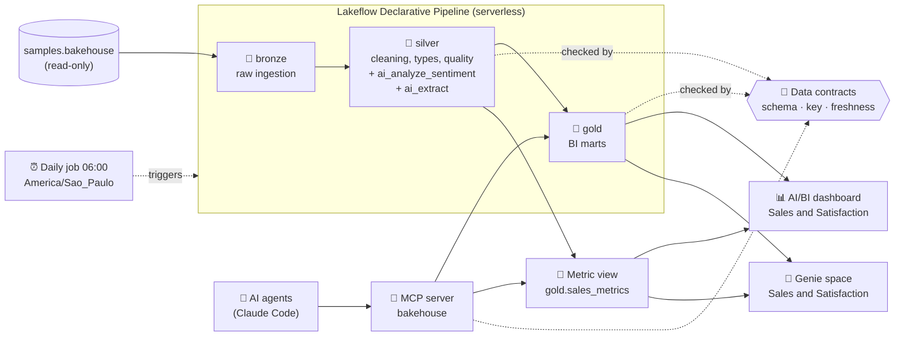
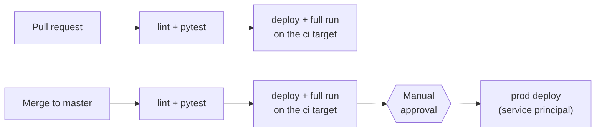

# Bakehouse Lakehouse

[🇧🇷 Português](README.md) · 🇺🇸 English

**End-to-end lakehouse on Databricks: from ingestion to natural-language questions, with generative AI, data
contracts and CI/CD, fully declared as code and built with AI agents from specifications.**

[](https://github.com/altamiropedrosa/databricks_claude_code_bakehouse/actions/workflows/databricks.yml)


[](LICENSE)


A **medallion architecture** pipeline (bronze → silver → gold) over the `samples.bakehouse` sample dataset, a
fictional bakery chain. Customer reviews are read by **generative AI**, which tells not only whether the customer
liked it, but **which product and why**. Business metrics have a **single definition**, and any manager can ask
*"why are this franchise's reviews negative?"* and get the answer straight from the data.

> The project is written in Portuguese: the dashboard, the Genie space, the specs and the detailed docs are in
> Portuguese, while code, table and column names are in English.

## By the numbers

| 17 | 9 | 213 | 3 | 3 | 25 |
|:---:|:---:|:---:|:---:|:---:|:---:|
| pipeline tables | data contracts | automated tests | environments (dev, ci, prod) | specs (SDD) | reviewed pull requests |

## At a glance

- **Serverless declarative pipeline** (Lakeflow) with 17 tables in three layers, written in SQL.
- **Generative AI on the data:** review sentiment (`ai_analyze_sentiment`) and **opinion per product**
  (`ai_extract`): which product was criticized and why. Each review is sent to the model **only once**.
- **Data contracts** (ODCS v3) enforced on every pull request and after every production run.
- **Semantic layer** (metric view) with the sales metrics, shared by the dashboard, Genie and the MCP server.
- **AI/BI dashboard** and **Genie space** for natural-language questions.
- **Custom MCP server:** AI agents query the data through the governed rules, read-only and without free-form SQL.
- **Spec-Driven Development:** every new feature starts from a specification with acceptance criteria, approved
  before any code and measured after delivery.
- **CI/CD with GitHub Actions:** offline tests, an integration environment, manual approval and production deploys
  through a service principal.
- **Everything as code** with Declarative Automation Bundles (DABs): schemas, pipeline, job, contracts, metrics,
  dashboard and Genie are promoted across environments by changing only the catalog.

## What this project demonstrates

| Skill | How it shows up here | Where to look |
|---|---|---|
| Data engineering | Medallion with streaming tables and materialized views, incremental ingestion, data quality expectations | [`src/pipelines/`](src/pipelines/bakehouse/transformations), [data layers](docs/camadas-de-dados.md) |
| Applied generative AI | Sentiment and per-product opinions extracted from reviews with AI Functions in SQL; Genie answering natural-language questions over governed metrics | [`reviews_sentiment.sql`](src/pipelines/bakehouse/transformations/silver/reviews_sentiment.sql), [`review_product_opinions.sql`](src/pipelines/bakehouse/transformations/silver/review_product_opinions.sql), [`genie/`](genie/README.md) |
| Quality and governance | ODCS v3 contracts with SemVer, personal-data tags in Unity Catalog, card number masking | [`contracts/`](contracts/README.md) |
| Analytics modeling | Additive gold marts and a metric view with reusable dimensions and measures | [`semantic/`](semantic/README.md) |
| DevOps / DataOps | Infrastructure as code, three environments, integration gate, approval-gated deploys | [`databricks.yml`](databricks.yml), [CI/CD](docs/ci-cd.md) |
| Automated testing | 200+ offline tests covering conventions, contracts, the semantic layer, product opinions and the MCP server | [`tests/`](tests), [development](docs/desenvolvimento.md#testes) |
| Spec-Driven Development | Specs with data evidence, acceptance criteria and review decisions, approved before code; results measured in dev and production | [`specs/`](specs/README.md) |
| Model Context Protocol (MCP) | Custom MCP server exposing the governed layer to AI agents, read-only and without free-form SQL | [MCP server](#mcp-server-for-ai-agents), [`src/mcp_server/`](src/mcp_server) |
| AI-assisted development | AI agent as a pair programmer, with guardrails, skills, hooks and human review before every delivery | [AI-assisted development](#ai-assisted-development) |

## Architecture



The daily job chains four tasks: **pipeline → contract checks → metric views → Genie**. If a contract is
violated, the job stops there and the metrics are not republished with non-compliant data.

| Layer | Tables | Role |
|---|---|---|
| 🥉 Bronze | 5 streaming tables | Faithful, incremental copy of the source with ingestion metadata. The only layer that reads `samples.bakehouse` |
| 🥈 Silver | 3 materialized views + 2 streaming tables | Types, standardization, enrichment, quality expectations, AI sentiment and opinions |
| 🥇 Gold | 7 marts | Sales by day, product and country, franchise performance, sentiment and opinions, top customers |

## What the data shows

Production figures, for sales from May 1 to 17, 2024 and the 204 customer reviews:

- **Two markets drive revenue.** Japan and the United States account for 64% of the 66,471 in revenue (3,333
  orders, average ticket of 19.94).
- **Satisfaction is the weak spot:** 42% of the reviews are negative and only 25% are positive. The worst
  franchise is Tokyo Treats, in Tokyo, with a net sentiment of -0.50.
- **The main problem is the taste of two products.** Golden Gate Ginger (73 criticisms) and Orchard Oasis (72)
  are the most criticized, almost always for their taste.
- **Two other products have both taste and texture issues.** Austin Almond Biscotti and Outback Oatmeal split their
  criticisms between the two (for example, "dry and crumbly").

The data is synthetic, and AI extraction is not deterministic. [Spec 001](specs/001-opinioes-por-produto.md)
records the measured quality and the limitations.

## AI on the data

**Review sentiment.** `silver.reviews_sentiment` labels each review as `positive`, `negative`, `neutral` or
`mixed` with the `ai_analyze_sentiment` AI Function, right in the pipeline SQL, with no model endpoint to
maintain. The gold layer aggregates it into a `net_sentiment` ∈ [-1, 1] per franchise.

**Why sentiment is bad.** `silver.review_product_opinions` uses `ai_extract` to get, from each review, **which
product was praised or criticized and for what reason** (taste, texture, freshness, price, availability). The
dashboard shows the most criticized product of each franchise, and Genie answers questions such as *"Why are Tokyo
Treats' reviews negative?"*. The feature started from a [specification approved before any
code](specs/001-opinioes-por-produto.md), with measured acceptance criteria.


**Natural-language questions.** The Genie space *Bakehouse Lakehouse - Vendas e Satisfação* answers questions
(in Portuguese) such as *"Which franchises have the worst review sentiment?"*. It queries the metric view, so the
AI uses the **same revenue and average-ticket definitions** as the dashboard instead of inventing its own. Its
configuration (instructions, sample questions, tables) is versioned in YAML and published by the job.


## MCP server for AI agents

The `bakehouse` [MCP](https://modelcontextprotocol.io) server ([docs/mcp.md](docs/mcp.md)) lets any AI agent,
such as Claude Code, query the data **through the same definitions as the dashboard and Genie**: sales through the
metric view, opinions and sentiment through the gold marts, and contracts through the versioned files. It is
read-only and does not accept free-form SQL: measures, dimensions and columns come from allowlists read from
`semantic/` and `contracts/`, values travel as parameters, and personal data never leaves. Anyone who clones the
repository gets it configured in [`.mcp.json`](.mcp.json). It started from [spec 002](specs/002-servidor-mcp.md)
and was verified in dev and production with real Claude Code sessions answering only with the server's tools.

## Quality and governance

Every published table has a **data contract** in the
[Open Data Contract Standard (ODCS) v3](https://bitol-io.github.io/open-data-contract-standard/) format, with
columns, types, primary key, personal-data classification, owner and SLA (daily refresh, at most 26 h).

| When | What it guarantees |
|---|---|
| On the pull request (CI, offline) | The SQL declares exactly the contract's columns, types, `NOT NULL`, comments and expectations; a breaking change requires a MAJOR version |
| In the table | Required columns are `NOT NULL`: an unexpected null fails the pipeline instead of reaching the dashboard |
| After every run | What **was published** matches the contract (schema, key without duplicates, freshness); `data_contract` and `classification` tags applied in Unity Catalog |

The **semantic layer** `gold.sales_metrics` defines 13 dimensions and 7 sales measures only once, and never
exposes personal-data columns (checked in CI):

```sql
SELECT franchise_country, MEASURE(revenue) AS revenue, MEASURE(avg_ticket) AS avg_ticket
FROM bakehouse_prod.gold.sales_metrics
GROUP BY ALL;
```

## CI/CD and environments



| | `dev` | `ci` | `prod` |
|---|---|---|---|
| Catalog | `bakehouse_dev` | `bakehouse_ci` | `bakehouse_prod` |
| Deploy | Developer, from the CLI | GitHub Actions | GitHub Actions, after approval |
| Schedule | Paused | Paused (CI triggers it) | Daily, 06:00 |

Nobody deploys to production from their own machine: the deploy runs in CI, as a service principal with OAuth
M2M, only after the whole job passes in the integration environment and after a manual approval.

## Technical decisions

| Decision | Why |
|---|---|
| Sentiment and opinions in **streaming tables**, not materialized views | Each review is sent to the AI only once. A materialized view could reprocess every review on each refresh and multiply the inference cost |
| **Opinion per product** with `ai_extract`, not general topics with `ai_classify` | Tested during exploration: with general topics, "texture" showed up in 100% of the reviews and explained nothing. Per product, the patterns become actionable (see [spec 001](specs/001-opinioes-por-produto.md)) |
| **The catalog is the only difference** between environments | The same SQL runs in dev, ci and prod; promoting means changing one variable. Tests forbid hardcoded catalogs |
| `dev` target **without** `mode: development` | That mode prefixes schemas with the user name; here they must be named exactly `bronze`, `silver` and `gold`. Its benefits are replicated with *presets* |
| Integration gate on the `ci` target | An environment shaped like prod (service principal, `run_as`) runs the full job before any deploy. Permission or data errors surface on the PR, not in production |
| **Prod never goes back in time** | After approval, the deploy checks that the commit is still the tip of `master`. An old *Re-run* aborts instead of overwriting a newer version |
| Contracts enforced **before and after** | The PR test catches errors early and cheaply; the post-run check catches what only real data reveals (duplicates, staleness) |
| **One owner per metric** | An average ticket computed as an average of averages is wrong when aggregated. The metric view recomputes the ratio at any grain, and the dashboard, Genie and the MCP server share the same definition |
| MCP server **without free-form SQL** | The server's value is querying only through governed definitions. Allowlists read from versioned files make a new measure available without code changes, and a column marked as personal data in a contract is blocked automatically (see [spec 002](specs/002-servidor-mcp.md)) |
| Expectations that **drop** vs. that **record** | A row without a key or with an impossible value is dropped; a tolerable inconsistency (e.g. total ≠ quantity × price) is only measured, without losing data |
| Card reduced to its **last 4 digits** in silver | Sensitive data never reaches the layers used by BI and AI |

## AI-assisted development

The project was built with an AI agent ([Claude Code](https://claude.com/claude-code)) as a pair programmer. The
agent's autonomy is bounded by a process and by explicit guardrails:

- **Spec-Driven Development** in [`specs/`](specs/README.md): every new feature starts from a specification with
  data evidence and acceptance criteria, reviewed and approved in its own PR **before** any code. The
  implementation measures each criterion, and the spec records the results in dev and production.
- **Human review before every delivery:** the agent opens the PRs, but merging and approving production deploys are
  always done by the author.
- **Instructions and skills** in [`AGENTS.md`](AGENTS.md): the agent uses the Databricks skills to follow the
  authentication, data exploration and bundle deployment workflows.
- **Blocklist** in [`.claude/settings.json`](.claude/settings.json): the agent cannot destroy the bundle, delete
  catalogs, schemas or tables, deploy to prod or `push --force`.
- **Safety hook** in [`.claude/hooks/block_destructive.py`](.claude/hooks/block_destructive.py), which intercepts
  every command before it runs and blocks `DROP`, `TRUNCATE`, `DELETE FROM` and CLI deletions, including calls to
  the project's MCP tools. It fails closed: when in doubt, it blocks.
- **MCP integration:** the [`bakehouse` server](docs/mcp.md) gives the agent access to the data through governed
  definitions instead of free-form SQL.
- **Tests and CI as a safety net:** all code, generated or not, goes through lint, offline tests and a full run in
  the integration environment before reaching production.

## Stack

**Databricks:** Lakeflow Declarative Pipelines · Lakeflow Jobs · Unity Catalog · AI Functions · Metric Views ·
AI/BI Dashboards · Genie · serverless compute · Declarative Automation Bundles<br/>
**Languages:** SQL (pipeline) · Python 3.12 (job tasks, MCP server and tests)<br/>
**AI:** AI Functions (`ai_analyze_sentiment`, `ai_extract`) · Genie · Model Context Protocol (`mcp` SDK) · Claude Code<br/>
**Quality:** Open Data Contract Standard v3 · pytest · ruff<br/>
**Delivery:** GitHub Actions · OAuth M2M with a service principal · uv

## Getting started

Prerequisites: a Databricks workspace with Unity Catalog and serverless, Databricks CLI v1.21.0, uv and Python 3.12.

```bash
databricks auth login --host https://<your-workspace>.cloud.databricks.com
uv sync --dev
DATABRICKS_SKIP_CONNECT=1 uv run pytest      # offline tests
databricks bundle deploy                     # deploys to dev
databricks bundle run bakehouse_medallion_job
```

To use the MCP server, open Claude Code in the project folder and approve the `bakehouse` server
([docs/mcp.md](docs/mcp.md)). The full walkthrough is in [docs/desenvolvimento.md](docs/desenvolvimento.md)
(Portuguese).

## Next steps

- **AI quality with human evaluation:** product-opinion extraction quality was measured on a sample labeled by
  another model ([spec 001](specs/001-opinioes-por-produto.md), CA5); human labeling is still missing, for sentiment too.
- **Versioned Genie benchmarks**, with questions and expected SQL.
- **An opinions metric view**, so that Genie and the MCP server compute criticism shares through the semantic layer.
- **MCP server as a Databricks App**, for remote access without running anything on the user's machine.
- Cost per run from the billing system tables.
- A data quality page in the dashboard, with expectation metrics read from the pipeline event log.

## About this project

This project is part of my Career Break, dedicated to studying English and **AI-Assisted Engineering**: building
data pipelines and analytics with AI agents ([Claude Code](https://claude.com/claude-code)), using
[Spec-Driven Development](specs/README.md), with specifications and acceptance criteria approved before any code,
change planning, automation with [hooks](.claude/hooks/block_destructive.py) and skills, MCP integrations (including
a [custom MCP server](docs/mcp.md)) and human review before every delivery.

## Author

**Altamiro Pedrosa** · [LinkedIn](https://www.linkedin.com/in/altamiropedrosa) · [GitHub](https://github.com/altamiropedrosa)

## License

[MIT](LICENSE). The `samples.bakehouse` dataset is sample data provided by Databricks.
