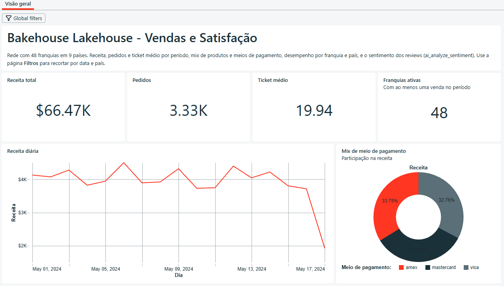
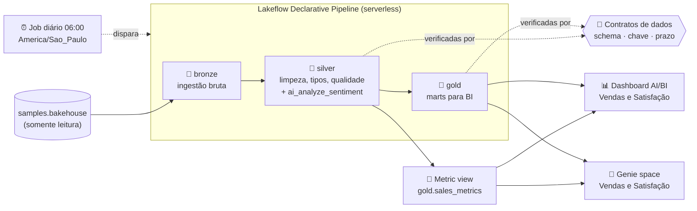
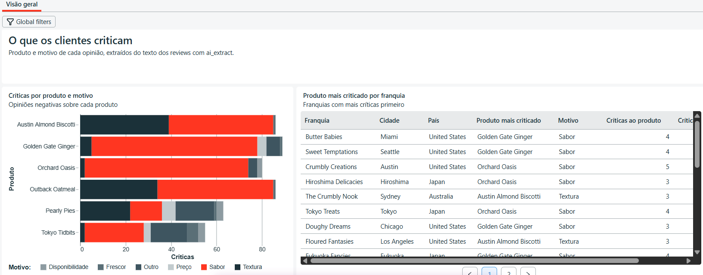
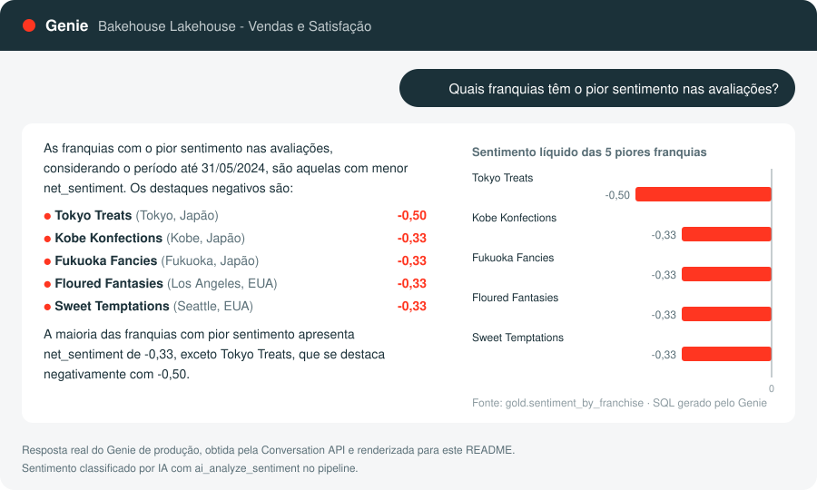
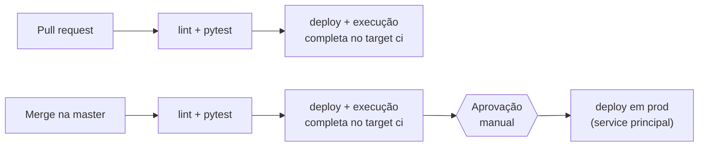

# Bakehouse Lakehouse

**Lakehouse de ponta a ponta no Databricks: da ingestão à pergunta em linguagem natural, com IA generativa,
contratos de dados e CI/CD, tudo declarado como código.**

[](https://github.com/altamiropedrosa/databricks_claude_code_bakehouse/actions/workflows/databricks.yml)




Pipeline em **arquitetura medalhão** (bronze → silver → gold) sobre o dataset de exemplo `samples.bakehouse`,
uma rede fictícia de padarias. As avaliações dos clientes são classificadas por **IA generativa**, as métricas
de negócio têm uma **definição única** e qualquer gestor pode perguntar em português *"qual franquia vendeu
mais no último mês?"* e receber a resposta direto dos dados.

## Em resumo

- **Pipeline declarativo serverless** (Lakeflow) com 17 tabelas em três camadas, escrito em SQL.
- **Análise de sentimento com IA** (`ai_analyze_sentiment`) sobre as avaliações, pontuando cada uma **uma única vez**,
  e **opinião por produto** (`ai_extract`): qual produto foi criticado e por quê.
- **Contratos de dados** (ODCS v3) cobrados no pull request e após cada execução em produção.
- **Camada semântica** (metric view) com as métricas de vendas, compartilhada pelo dashboard e pelo Genie.
- **Dashboard AI/BI** e **Genie space** para perguntas em linguagem natural.
- **CI/CD com GitHub Actions:** testes offline, ambiente de integração, aprovação manual e deploy em produção
  por um service principal.
- **Tudo como código** com Declarative Automation Bundles (DABs): schemas, pipeline, job, contratos, métricas,
  dashboard e Genie são promovidos entre ambientes trocando apenas o catálogo.

## O que este projeto demonstra

| Competência | Como aparece aqui | Onde ver |
|---|---|---|
| Engenharia de dados | Medalhão com streaming tables e materialized views, ingestão incremental, expectations de qualidade | [`src/pipelines/`](src/pipelines/bakehouse/transformations), [camadas de dados](docs/camadas-de-dados.md) |
| IA generativa aplicada | Sentimento e opinião por produto extraídos das avaliações com AI Functions em SQL; Genie respondendo em linguagem natural sobre métricas governadas | [`reviews_sentiment.sql`](src/pipelines/bakehouse/transformations/silver/reviews_sentiment.sql), [`genie/`](genie/README.md) |
| Qualidade e governança | Contratos ODCS v3 com SemVer, tags de dado pessoal no Unity Catalog, mascaramento do cartão | [`contracts/`](contracts/README.md) |
| Modelagem analítica | Marts gold aditivos e metric view com dimensões e medidas reutilizáveis | [`semantic/`](semantic/README.md) |
| DevOps / DataOps | Infraestrutura como código, três ambientes, gate de integração, deploy com aprovação | [`databricks.yml`](databricks.yml), [CI/CD](docs/ci-cd.md) |
| Testes automatizados | Mais de 170 testes offline cobrando convenções, contratos e camada semântica | [`tests/`](tests), [desenvolvimento](docs/desenvolvimento.md#testes) |
| Desenvolvimento com IA | Agente de IA como par de programação, com guardrails que bloqueiam ações destrutivas | [Desenvolvimento assistido por IA](#desenvolvimento-assistido-por-ia) |

## Arquitetura



O job diário encadeia quatro tarefas: **pipeline → verificação dos contratos → metric views → Genie**.
Se um contrato for violado, o job para ali e as métricas não são republicadas com dados fora do padrão.

| Camada | Tabelas | Papel |
|---|---|---|
| 🥉 Bronze | 5 streaming tables | Cópia fiel e incremental da origem, com metadados de ingestão. Única camada que lê `samples.bakehouse` |
| 🥈 Silver | 3 materialized views + 2 streaming tables | Tipos, padronização, enriquecimento, expectations de qualidade, sentimento e opiniões por IA |
| 🥇 Gold | 7 marts | Vendas por dia, produto e país, desempenho, sentimento e opiniões por franquia, ranking de clientes |

Detalhe de cada tabela em [docs/camadas-de-dados.md](docs/camadas-de-dados.md).

## IA nos dados

**Sentimento das avaliações.** A tabela `silver.reviews_sentiment` classifica cada avaliação como `positive`,
`negative`, `neutral` ou `mixed` com a AI Function `ai_analyze_sentiment`, direto no SQL do pipeline, sem
endpoint de modelo para manter. A gold agrega o resultado em um `net_sentiment` ∈ [-1, 1] por franquia.

**Por que o sentimento é ruim.** A tabela `silver.review_product_opinions` usa `ai_extract` para tirar de cada
avaliação **qual produto foi elogiado ou criticado e por qual motivo** (sabor, textura, frescor, preço,
disponibilidade). O dashboard mostra o produto mais criticado de cada franquia, e o Genie responde perguntas como
*"Por que as avaliações da Tokyo Treats são negativas?"*. A funcionalidade nasceu de uma
[especificação aprovada antes do código](specs/001-opinioes-por-produto.md), com critérios de aceite medidos.



**Perguntas em linguagem natural.** O Genie space *Bakehouse Lakehouse - Vendas e Satisfação* responde em português
perguntas como *"Quais franquias têm o pior sentimento nas avaliações?"*. Ele consulta a metric view, então
a IA usa as **mesmas definições de receita e ticket médio** do dashboard em vez de inventar o próprio cálculo.
A configuração (instruções, perguntas de exemplo, tabelas) é versionada em YAML e publicada pelo job.



## Qualidade e governança

Cada tabela publicada tem um **contrato de dados** no formato
[Open Data Contract Standard (ODCS) v3](https://bitol-io.github.io/open-data-contract-standard/), com colunas,
tipos, chave primária, classificação de dado pessoal, dono e SLA (atualização diária, no máximo 26 h).

| Quando | O que garante |
|---|---|
| No pull request (CI, offline) | O SQL declara exatamente as colunas, tipos, `NOT NULL`, comentários e expectations do contrato; mudança incompatível exige versão MAJOR |
| Na tabela | Colunas obrigatórias são `NOT NULL`: um nulo inesperado falha o pipeline em vez de chegar ao dashboard |
| Após cada execução | O que **foi publicado** bate com o contrato (schema, chave sem duplicatas, prazo); tags `data_contract` e `classification` aplicadas no Unity Catalog |

A **camada semântica** `gold.sales_metrics` define uma única vez 13 dimensões e 7 medidas de vendas, e nunca
expõe colunas de dado pessoal (verificado no CI):

```sql
SELECT franchise_country, MEASURE(revenue) AS receita, MEASURE(avg_ticket) AS ticket_medio
FROM bakehouse_prod.gold.sales_metrics
GROUP BY ALL;
```

Mais em [contracts/README.md](contracts/README.md) e [semantic/README.md](semantic/README.md).

## CI/CD e ambientes



| | `dev` | `ci` | `prod` |
|---|---|---|---|
| Catálogo | `bakehouse_dev` | `bakehouse_ci` | `bakehouse_prod` |
| Deploy | Desenvolvedor, pela CLI | GitHub Actions | GitHub Actions, após aprovação |
| Agendamento | Pausado | Pausado (o CI dispara) | Diário, 06:00 |

Ninguém publica em produção pela própria máquina: o deploy é feito pelo CI, como service principal com OAuth
M2M, só depois de o job inteiro passar no ambiente de integração e de uma aprovação manual. Detalhes em
[docs/ci-cd.md](docs/ci-cd.md).

## Decisões técnicas

| Decisão | Por quê |
|---|---|
| Sentimento em **streaming table**, não materialized view | Cada avaliação é enviada à IA uma única vez. Uma materialized view poderia reprocessar todas a cada atualização e multiplicar o custo de inferência |
| **O catálogo é a única diferença** entre ambientes | O mesmo SQL roda em dev, ci e prod; promover é trocar uma variável. Testes impedem catálogo fixo no código |
| Target `dev` **sem** `mode: development` | Esse modo prefixa os schemas com o nome do usuário; aqui eles precisam se chamar exatamente `bronze`, `silver` e `gold`. Os benefícios do modo são replicados com *presets* |
| Gate de integração no target `ci` | Ambiente com o mesmo formato de prod (service principal, `run_as`), que roda o job completo antes de qualquer deploy. Erros de permissão ou de dados aparecem no PR, não em produção |
| **Prod nunca volta no tempo** | Depois da aprovação, o deploy confere se o commit ainda é a ponta da `master`. Um *Re-run* antigo aborta em vez de sobrescrever uma versão mais nova |
| Contratos cobrados **antes e depois** | O teste no PR pega o erro cedo e barato; a verificação após a execução pega o que só aparece com dados reais (duplicatas, atraso) |
| **Métrica com um só dono** | Ticket médio calculado como média de médias dá resultado errado ao agregar. A metric view recalcula a razão em qualquer nível, e dashboard e Genie usam a mesma definição |
| Expectations que **descartam** vs. que **registram** | Linha sem chave ou com valor impossível é descartada; inconsistência tolerável (ex.: total ≠ quantidade × preço) só é medida, sem perder dado |
| Cartão reduzido aos **4 últimos dígitos** já na silver | O dado sensível não chega às camadas consumidas por BI e IA |

## Desenvolvimento assistido por IA

O projeto foi desenvolvido com um agente de IA ([Claude Code](https://claude.com/claude-code)) como par de
programação, com autonomia limitada por guardrails explícitos:

- **Instruções do projeto** em [`AGENTS.md`](AGENTS.md), para o agente seguir o fluxo de autenticação e de
  deploy do bundle.
- **Lista de bloqueios** em [`.claude/settings.json`](.claude/settings.json): o agente não pode destruir o bundle,
  apagar catálogos, schemas ou tabelas, fazer deploy em prod nem `push --force`.
- **Hook de segurança** em [`.claude/hooks/block_destructive.py`](.claude/hooks/block_destructive.py), que
  intercepta todo comando antes de executar e bloqueia `DROP`, `TRUNCATE`, `DELETE FROM` e remoções pela CLI,
  inclusive SQL enviado por ferramentas MCP. Ele falha fechado: na dúvida, bloqueia.
- **Testes e CI como rede de segurança:** todo código, gerado ou não, passa por lint, testes offline e
  execução completa no ambiente de integração antes de chegar a produção, que só recebe deploy com aprovação humana.

## Stack

**Databricks:** Lakeflow Declarative Pipelines · Lakeflow Jobs · Unity Catalog · AI Functions · Metric Views ·
AI/BI Dashboards · Genie · computação serverless · Declarative Automation Bundles<br/>
**Linguagens:** SQL (pipeline) · Python 3.12 (tarefas do job e testes)<br/>
**Qualidade:** Open Data Contract Standard v3 · pytest · ruff<br/>
**Entrega:** GitHub Actions · OAuth M2M com service principal · uv

## Como executar

Pré-requisitos: workspace Databricks com Unity Catalog e serverless, Databricks CLI v1.21.0, uv e Python 3.12.

```bash
databricks auth login --host https://<seu-workspace>.cloud.databricks.com
uv sync --dev
DATABRICKS_SKIP_CONNECT=1 uv run pytest      # testes offline
databricks bundle deploy                     # publica em dev
databricks bundle run bakehouse_medallion_job
```

Passo a passo completo, estrutura do repositório e convenções em [docs/desenvolvimento.md](docs/desenvolvimento.md).

## Próximos passos

- **Avaliar a qualidade da IA:** comparar o sentimento do modelo com uma amostra rotulada manualmente.
- **Benchmarks do Genie** versionados, com perguntas e SQL esperado.
- Custo por execução a partir das system tables de billing.
- Página de qualidade no dashboard com as métricas das expectations, lidas do event log do pipeline.

## Documentação

| Documento | Conteúdo |
|---|---|
| [specs/](specs/README.md) | Especificações: cada funcionalidade nova começa por uma spec aprovada antes do código |
| [docs/camadas-de-dados.md](docs/camadas-de-dados.md) | Cada tabela das camadas bronze, silver e gold, e o dashboard |
| [docs/desenvolvimento.md](docs/desenvolvimento.md) | Pré-requisitos, desenvolvimento local, testes, estrutura do repositório e convenções |
| [docs/ci-cd.md](docs/ci-cd.md) | Ambientes, fluxo de CI/CD e configuração de produção |
| [docs/solucao-de-problemas.md](docs/solucao-de-problemas.md) | Problemas reais encontrados, com causa e solução |
| [contracts/README.md](contracts/README.md) | Contratos de dados: formato, regras de versão e passo a passo |
| [semantic/README.md](semantic/README.md) | Camada semântica: dimensões, medidas e como evoluir |
| [genie/README.md](genie/README.md) | Genie space: configuração e publicação |

### Referências

[Declarative Automation Bundles](https://docs.databricks.com/dev-tools/bundles/index.html) ·
[Lakeflow Declarative Pipelines](https://docs.databricks.com/aws/en/dlt/) ·
[ODCS](https://bitol-io.github.io/open-data-contract-standard/) ·
[Metric views](https://docs.databricks.com/metric-views/) ·
[Genie](https://docs.databricks.com/genie/) ·
[`ai_analyze_sentiment`](https://docs.databricks.com/aws/en/sql/language-manual/functions/ai_analyze_sentiment) ·
[OAuth M2M](https://docs.databricks.com/aws/en/dev-tools/auth/oauth-m2m)

## Autor

**Altamiro Pedrosa** · [LinkedIn](https://www.linkedin.com/in/altamiropedrosa) · [GitHub](https://github.com/altamiropedrosa)
