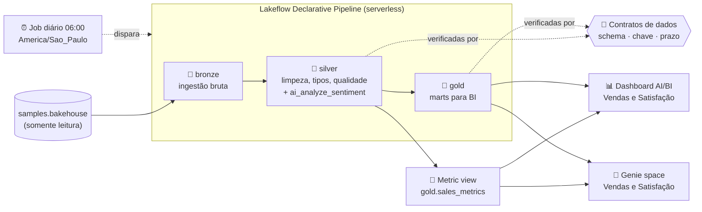
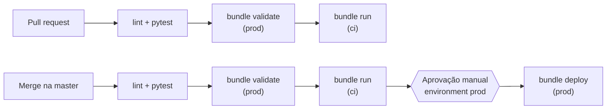

# Bakehouse Lakehouse — Databricks Asset Bundle

[](https://github.com/altamiropedrosa/databricks_claude_code_bakehouse/actions/workflows/databricks.yml)

Pipeline de dados em **arquitetura medalhão** (bronze → silver → gold) sobre o dataset de exemplo
`samples.bakehouse`, com **análise de sentimento por IA** das avaliações de clientes, **contratos de dados**
verificados a cada execução, uma **camada semântica** (metric view) com as métricas de negócio, um
**dashboard AI/BI**, um **Genie space** para perguntas em linguagem natural e **CI/CD com GitHub Actions**
fazendo deploy em produção por um service principal.

Todo o projeto é declarado como código com **Declarative Automation Bundles (DABs)**: schemas, pipeline,
job, contratos, métricas, dashboard e Genie são versionados neste repositório e promovidos entre ambientes
trocando apenas o catálogo.

---

## Sumário

- [Arquitetura](#arquitetura)
- [Camadas de dados](#camadas-de-dados)
- [Contratos de dados](#contratos-de-dados)
- [Camada semântica e Genie](#camada-semântica-e-genie)
- [Estrutura do repositório](#estrutura-do-repositório)
- [Ambientes](#ambientes)
- [Pré-requisitos](#pré-requisitos)
- [Desenvolvimento local](#desenvolvimento-local)
- [CI/CD](#cicd)
- [Configuração do ambiente de produção](#configuração-do-ambiente-de-produção)
- [Convenções do projeto](#convenções-do-projeto)
- [Solução de problemas](#solução-de-problemas)

---

## Arquitetura



| Componente | Onde fica | Descrição |
|---|---|---|
| Schemas | `resources/bakehouse.schemas.yml` | Um schema Unity Catalog por camada: `bronze`, `silver`, `gold` |
| Pipeline | `resources/bakehouse.pipeline.yml` | Pipeline declarativo único e serverless com as três camadas, em SQL |
| Contratos de dados | `contracts/` | Interface de cada tabela publicada (ODCS v3), cobrada no CI e a cada execução |
| Camada semântica | `semantic/` | Metric view `gold.sales_metrics`: as métricas de vendas definidas uma única vez |
| Genie space | `genie/` | Perguntas em linguagem natural sobre vendas e satisfação |
| Job | `resources/bakehouse.job.yml` | Diariamente às 06:00 (pausado em dev e ci): pipeline → verificação dos contratos → metric views → Genie |
| Dashboard | `resources/bakehouse.dashboard.yml` | Dashboard AI/BI sobre a metric view e as tabelas gold |

## Camadas de dados

### 🥉 Bronze — ingestão

Streaming tables com ingestão incremental e cópia fiel das colunas de origem, acrescidas dos metadados
`_ingested_at` e `_source_table`. É a **única** camada que lê `samples.bakehouse`.

`customers` · `franchises` · `reviews` · `suppliers` · `transactions`

### 🥈 Silver — dados limpos e conformados

| Tabela | Tipo | Destaques |
|---|---|---|
| `customers` | Materialized view | Dimensão de clientes com país padronizado (`USA`/`US` → `United States`) |
| `franchises` | Materialized view | Dimensão de franquias com localização validada, enriquecida com o fornecedor |
| `transactions` | Materialized view | Tipos corretos, colunas de data derivadas, enriquecida com franquia e cliente. Do cartão, só os **4 últimos dígitos** são mantidos |
| `reviews_sentiment` | Streaming table | Sentimento classificado com `ai_analyze_sentiment`. Por ser streaming, cada avaliação é pontuada **uma única vez** |

**Qualidade de dados:** as tabelas silver usam *expectations*. Registros sem chave, com quantidade ou valor
não positivos são **descartados**; inconsistências como `total_price ≠ quantity × unit_price` ou meio de
pagamento desconhecido são **registradas** nas métricas do pipeline, sem descartar a linha.

### 🥇 Gold — marts para BI

| Tabela | Granularidade | Uso |
|---|---|---|
| `daily_sales_by_franchise` | dia × franquia × meio de pagamento | Tendência de vendas e mix de pagamento |
| `sales_by_product` | produto × dia × país | Mix de produtos por período e país |
| `sales_by_country` | país da franquia | Receita e participação por país |
| `franchise_performance` | franquia | Desempenho acumulado e coordenadas para mapas |
| `sentiment_by_franchise` | franquia | Contagens e `net_sentiment` ∈ [-1, 1] |
| `top_customers` | cliente | Ranking por receita e produto favorito |

As medidas das tabelas diárias são **aditivas**: qualquer agregação é um `SUM`. Para receita, pedidos,
ticket médio e afins, prefira a [camada semântica](#camada-semântica-e-genie) (`gold.sales_metrics`), que já
recalcula razões como o ticket médio corretamente em qualquer nível de agregação.

### 📊 Dashboard

**`[<target>] Bakehouse - Vendas e Satisfacao`**, com as páginas *Visão geral* e *Filtros*. Vendas diárias e
mix de produtos vêm da metric view `gold.sales_metrics` (via `MEASURE()`); desempenho das franquias e
sentimento vêm das tabelas gold.

## Contratos de dados

Cada tabela publicada tem um **contrato de dados** em `contracts/<camada>/<tabela>.yaml`, no formato
[Open Data Contract Standard (ODCS) v3](https://bitol-io.github.io/open-data-contract-standard/). Hoje: as
6 tabelas gold (obrigatório) e `silver.transactions`, base da camada semântica.

O contrato define colunas, tipos, obrigatoriedade (`required` vira `NOT NULL`), chave primária, descrição,
classificação de dado pessoal, regras de qualidade, dono e SLA (atualização diária, no máximo 26 h). Ele é
cobrado em três momentos:

| Quando | O que garante | Onde |
|---|---|---|
| No PR (CI, offline) | O SQL declara exatamente as colunas, tipos, `NOT NULL`, comentários e expectations do contrato; mudança incompatível exige versão MAJOR | `tests/test_data_contracts.py` |
| Na tabela | Colunas obrigatórias são `NOT NULL`: um nulo inesperado falha o pipeline em vez de chegar ao dashboard; a documentação aparece no Unity Catalog | SQL do pipeline |
| Após cada execução | O que **foi publicado** bate com o contrato: schema, chave sem duplicatas e prazo de atualização; aplica as tags `data_contract` e `classification` | Tarefa `enforce_data_contracts` do job |

**Versionamento (SemVer):** remover ou renomear coluna, mudar tipo ou deixar de ser obrigatória é mudança
**incompatível** (MAJOR); nova coluna é MINOR; só documentação é PATCH. Detalhes e passo a passo em
[contracts/README.md](contracts/README.md).

## Camada semântica e Genie

**Metric view `gold.sales_metrics`** ([semantic/README.md](semantic/README.md)): as métricas de vendas
definidas **uma única vez** sobre `silver.transactions`, com 13 dimensões (data, mês, produto, franquia, país,
pagamento...) e 7 medidas (`revenue`, `orders`, `units_sold`, `avg_ticket`, `units_per_order`,
`unique_customers`, `active_franchises`).

```sql
SELECT franchise_country, MEASURE(revenue) AS receita, MEASURE(avg_ticket) AS ticket_medio
FROM bakehouse_prod.gold.sales_metrics
GROUP BY ALL;
```

- Só pode usar colunas que estão no contrato da fonte, e nunca colunas de dado pessoal (verificado no CI).
- É republicada pelo job **depois** da verificação dos contratos: contrato violado não chega às métricas.

**Genie space `[<target>] Bakehouse - Vendas e Satisfação`** ([genie/README.md](genie/README.md)): perguntas
em português para gestores de negócio sobre vendas (pela metric view) e satisfação (`gold.sentiment_by_franchise`),
como *"Qual franquia teve a maior receita no último mês?"* ou *"Quais franquias têm o pior sentimento nas
avaliações?"*. A configuração é versionada em YAML e publicada pelo job em cada target. Edições feitas pela
interface são sobrescritas: altere sempre o YAML.

## Estrutura do repositório

```text
.
├── databricks.yml                      # Bundle: variáveis e targets (dev / ci / prod)
├── resources/                          # Definição dos recursos Databricks
│   ├── bakehouse.schemas.yml
│   ├── bakehouse.pipeline.yml
│   ├── bakehouse.job.yml
│   └── bakehouse.dashboard.yml
├── src/
│   ├── pipelines/bakehouse/transformations/
│   │   ├── bronze/                     # 5 tabelas de ingestão
│   │   ├── silver/                     # 4 tabelas limpas
│   │   └── gold/                       # 6 marts
│   ├── dashboards/bakehouse_sales.lvdash.json
│   └── jobs/
│       ├── enforce_data_contracts.py   # Confere tabelas publicadas x contratos (tarefa do job)
│       ├── publish_metric_views.py     # Publica a camada semântica (tarefa do job)
│       └── publish_genie_space.py      # Cria/atualiza o Genie space (tarefa do job)
├── semantic/gold/sales_metrics.yaml    # Metric view de vendas, ver semantic/README.md
├── genie/                              # Genie spaces versionados, ver genie/README.md
├── contracts/                          # Contratos de dados (ODCS v3), ver contracts/README.md
│   ├── silver/transactions.yaml
│   └── gold/                           # 1 contrato por mart
├── tests/
│   ├── test_bundle_conventions.py      # Testes offline das convenções do bundle
│   ├── test_data_contracts.py          # Testes offline: SQL x contrato e regras de versão
│   ├── test_enforce_data_contracts.py  # Testes offline da verificação em execução
│   ├── test_semantic_layer.py          # Testes offline da camada semântica x contratos
│   └── test_genie_space.py             # Testes offline do Genie space
└── .github/workflows/databricks.yml    # Pipeline de CI/CD
```

## Ambientes

O **catálogo é a única coisa que muda entre ambientes**. Os nomes dos schemas são sempre `bronze`, `silver` e `gold`.

| | `dev` (padrão) | `ci` | `prod` |
|---|---|---|---|
| Catálogo | `bakehouse_dev` | `bakehouse_ci` | `bakehouse_prod` |
| Quem faz deploy | Desenvolvedor, pela CLI | GitHub Actions, como service principal | GitHub Actions, como service principal |
| Executa como | Usuário que fez o deploy | Service principal `service_ci_cd` | Service principal `service_ci_cd` |
| Agendamento do job | Pausado | Pausado (o CI dispara a execução) | Ativo (06:00, `America/Sao_Paulo`) |
| Pipeline | Modo desenvolvimento | Modo desenvolvimento | Modo produção |
| Prefixo dos recursos | `[dev]` | `[ci]` | `[prod]` |

O target `ci` é o **gate de integração**: todo PR e todo push na `master` publicam o bundle nele e rodam o
job completo (pipeline, verificação dos contratos e metric views) antes de qualquer deploy em produção.

> **Atenção:** o target `dev` não usa `mode: development`, para manter os schemas sem o prefixo
> `dev_<usuario>_`. Por isso, **todos os desenvolvedores compartilham os mesmos schemas em `bakehouse_dev`**.

## Pré-requisitos

- [Databricks CLI](https://docs.databricks.com/dev-tools/cli/install) **v1.21.0** (a mesma versão usada no CI)
- [uv](https://docs.astral.sh/uv/getting-started/installation/) e Python **3.12**
- Workspace Databricks com Unity Catalog e computação serverless
- Catálogos `bakehouse_dev`, `bakehouse_ci` e `bakehouse_prod` já criados (o bundle cria os schemas, não os catálogos)
- SQL warehouse chamado **`Serverless Starter Warehouse`** (resolvido por nome no bundle)
- AI Functions disponíveis no workspace (para `ai_analyze_sentiment`)

## Desenvolvimento local

```bash
# 1. Autenticar no workspace
databricks auth login --host https://dbc-02964a61-2c9c.cloud.databricks.com

# 2. Instalar dependências de desenvolvimento
uv sync --dev

# 3. Lint e testes (offline, sem conexão com o Databricks)
uv run ruff check .
DATABRICKS_SKIP_CONNECT=1 uv run pytest -v

# 4. Validar, publicar e executar em dev
databricks bundle validate
databricks bundle deploy
databricks bundle run bakehouse_medallion_job
```

Os testes em `tests/test_bundle_conventions.py` verificam, sem conexão com o Databricks, as convenções
descritas abaixo: catálogo nunca fixo no código, cada SQL criando a tabela da própria camada, só a bronze
lendo a origem, configuração do pipeline vinda do bundle e widgets do dashboard ligados a campos existentes.

Os testes em `tests/test_data_contracts.py` verificam os [contratos de dados](contracts/README.md): toda tabela
gold tem contrato, o SQL declara exatamente as colunas, tipos, `NOT NULL`, comentários e expectations do
contrato, e mudanças incompatíveis exigem versão MAJOR em relação ao `origin/master`.

Em execução, o job `bakehouse_medallion_job` roda a tarefa `enforce_data_contracts` depois do pipeline: ela
confere o schema publicado no Unity Catalog, a unicidade da chave primária e o prazo de atualização de cada
contrato, aplica as tags de contrato e de dado pessoal, e falha a execução se algum contrato for violado.
Em seguida, a tarefa `publish_metric_views` republica a [camada semântica](semantic/README.md)
(`gold.sales_metrics`), que o dashboard usa para os dados de vendas, e a tarefa `publish_genie_space`
cria ou atualiza o [Genie space](genie/README.md) `[<target>] Bakehouse - Vendas e Satisfação` em cima dela.

## CI/CD

O workflow `.github/workflows/databricks.yml` implementa o fluxo:



| Job | Quando roda | Credenciais |
|---|---|---|
| `lint + pytest` | Todo PR, push na `master` e execução manual | Não usa |
| `bundle validate (prod)` | PR do próprio repositório, push na `master` e execução manual | Service principal |
| `bundle run (ci)` | Igual ao validate: publica no target `ci` e roda o job inteiro (pipeline, contratos, metric views) | Service principal |
| `bundle deploy (prod)` | Somente push na `master`, **após o `bundle run (ci)` passar e após aprovação** no environment `prod` | Service principal |

- PRs vindos de **fork** só executam lint e testes, pois não recebem secrets.
- Deploys em produção e no `ci` rodam **um por vez** e nunca são cancelados no meio, para não deixar o state travado.
- **Prod nunca volta no tempo:** depois da aprovação, o deploy confere se o commit ainda é a ponta da `master`.
  Se não for (um *Re-run* de execução antiga, ou um deploy já superado por outro merge), ele aborta sem publicar.
- O workflow também pode ser disparado manualmente (*Actions → Run workflow*) em qualquer branch, para rodar o
  gate de integração. A execução manual nunca faz deploy em prod.

## Configuração do ambiente de produção

Configuração necessária uma única vez para o CI conseguir publicar em produção.

**1. Service principal no Databricks**

- Crie um service principal (ex.: `service_ci_cd`) em *Workspace settings → Identity and access*.
- Gere um **OAuth secret** com escopo **`all-apis`** e guarde o valor, que é exibido uma única vez.

**2. Permissões no Unity Catalog**

```sql
GRANT USE CATALOG, CREATE SCHEMA ON CATALOG bakehouse_prod
  TO `<application-id-do-service-principal>`;
GRANT USE CATALOG, CREATE SCHEMA ON CATALOG bakehouse_ci
  TO `<application-id-do-service-principal>`;
```

O service principal passa a ser dono dos schemas que cria, sem precisar de outras permissões no catálogo.

**3. Secrets no GitHub** (*Settings → Secrets and variables → Actions*)

| Secret | Valor |
|---|---|
| `DATABRICKS_CLIENT_ID` | **Application ID** (UUID) do service principal, não o ID numérico |
| `DATABRICKS_CLIENT_SECRET` | Valor do OAuth secret (começa com `dose`) |

**4. Environment `prod` no GitHub** com pelo menos um *required reviewer*, para exigir aprovação antes do deploy.

## Convenções do projeto

- **Catálogo nunca fixo no código:** vem sempre de `${var.catalog}`, definido por target em `databricks.yml`.
- **Nomes de schema** vêm de `resources/bakehouse.schemas.yml` e chegam ao SQL pela configuração do pipeline
  (`${medallion_catalog}`, `${bronze_schema}`, `${silver_schema}`, `${gold_schema}`).
- **SQL sem `USE CATALOG`/`USE SCHEMA`:** todas as tabelas são totalmente qualificadas.
- **Fonte somente leitura:** apenas a bronze lê `samples.bakehouse`.
- **Dashboard** usa nomes de tabela sem catálogo/schema; ambos são injetados pelo bundle.
- **Contrato antes do SQL:** toda tabela gold tem um contrato em `contracts/`, e o SQL declara o schema
  explícito do contrato. Mudou a tabela, mudou o contrato (com versão).
- **Métrica tem um só dono:** receita, pedidos, ticket médio e afins vêm de `gold.sales_metrics`
  (`MEASURE()`), e não são recalculados em cada consulta.

Essas regras são verificadas automaticamente pelos testes.

## Solução de problemas

| Sintoma | Causa provável | Solução |
|---|---|---|
| `invalid_client` / `cannot configure default credentials` no CI | Client ID ou secret incorretos, ou secret criado sem o escopo `all-apis` | Gere um novo secret com escopo `all-apis` e atualize `DATABRICKS_CLIENT_SECRET` |
| `User does not have CREATE SCHEMA and USE CATALOG` no deploy | Service principal sem permissão no catálogo | Aplique o `GRANT` da seção de configuração |
| Dashboard sem dados após o primeiro deploy | O pipeline ainda não rodou | Execute `databricks bundle run bakehouse_medallion_job -t <target>` |
| Deploy parado em *Waiting* | Aguardando aprovação do environment `prod` | Aprove em *Actions → run → Review deployments* |
| Deploy parado em *Pending*, sem pedir aprovação | Uma execução mais antiga ainda aguarda aprovação e segura a fila `deploy-prod` | Rejeite a aprovação da execução antiga; a mais nova segue para aprovação |
| Deploy falha com `Deploy abortado: commits antigos nunca vao para prod` | O run é de um commit que não é mais a ponta da `master` (ex.: *Re-run* de execução antiga) | Comportamento esperado: nada foi publicado. Use o run do commit mais recente; não faça *Re-run* de execuções antigas |
| Job falha em `enforce_data_contracts` | O que foi publicado não bate com o contrato (schema, chave duplicada ou tabela atrasada) | O log da tarefa lista cada violação; corrija o SQL ou atualize o contrato (com versão) |
| Gráficos de vendas sem dados após um deploy | A metric view ainda não existe no target (só é criada quando o job roda) | Execute o job do target logo após o deploy |
| `METRIC_VIEW_INVALID_VIEW_DEFINITION` ao testar a metric view manualmente | `databricks experimental aitools tools query` altera a indentação de textos com várias linhas | Teste o `CREATE ... WITH METRICS` no SQL editor ou pela Statement Execution API |
| Mudança feita na interface do Genie sumiu | O job republica o Genie a partir de `genie/*.yaml` | Altere o YAML e publique |

## Referências

- [Declarative Automation Bundles](https://docs.databricks.com/dev-tools/bundles/index.html)
- [Lakeflow Declarative Pipelines](https://docs.databricks.com/aws/en/dlt/)
- [Open Data Contract Standard (ODCS)](https://bitol-io.github.io/open-data-contract-standard/)
- [Unity Catalog metric views](https://docs.databricks.com/metric-views/)
- [Genie](https://docs.databricks.com/genie/)
- [AI Functions — `ai_analyze_sentiment`](https://docs.databricks.com/aws/en/sql/language-manual/functions/ai_analyze_sentiment)
- [Autenticação OAuth M2M](https://docs.databricks.com/aws/en/dev-tools/auth/oauth-m2m)
