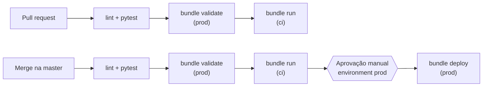

# Ambientes e CI/CD

Como o projeto é promovido de `dev` até `prod` e o que é preciso configurar uma única vez para o CI publicar
em produção.

- [Ambientes](#ambientes)
- [Fluxo de CI/CD](#fluxo-de-cicd)
- [Configuração do ambiente de produção](#configuração-do-ambiente-de-produção)

## Ambientes

O **catálogo é a única coisa que muda entre ambientes**. Os nomes dos schemas são sempre `bronze`, `silver` e `gold`.

| | `dev` (padrão) | `ci` | `prod` |
|---|---|---|---|
| Catálogo | `bakehouse_dev` | `bakehouse_ci` | `bakehouse_prod` |
| Quem faz deploy | Desenvolvedor, pela CLI | GitHub Actions, como service principal | GitHub Actions, como service principal |
| Executa como | Usuário que fez o deploy | Service principal `service_ci_cd` | Service principal `service_ci_cd` |
| Agendamento do job | Pausado | Pausado (o CI dispara a execução) | Ativo (06:00, `America/Sao_Paulo`) |
| Pipeline | Modo desenvolvimento | Modo desenvolvimento | Modo produção |
| Prefixo dos recursos | `[dev]` | `[ci]` | `[prod]` |

O target `ci` é o **gate de integração**: todo PR e todo push na `master` publicam o bundle nele e rodam o
job completo (pipeline, verificação dos contratos e metric views) antes de qualquer deploy em produção.

> **Atenção:** o target `dev` não usa `mode: development`, para manter os schemas sem o prefixo
> `dev_<usuario>_`. Por isso, **todos os desenvolvedores compartilham os mesmos schemas em `bakehouse_dev`**.

## Fluxo de CI/CD

O workflow `.github/workflows/databricks.yml` implementa o fluxo:



| Job | Quando roda | Credenciais |
|---|---|---|
| `lint + pytest` | Todo PR, push na `master` e execução manual | Não usa |
| `bundle validate (prod)` | PR do próprio repositório, push na `master` e execução manual | Service principal |
| `bundle run (ci)` | Igual ao validate: publica no target `ci` e roda o job inteiro (pipeline, contratos, metric views) | Service principal |
| `bundle deploy (prod)` | Somente push na `master`, **após o `bundle run (ci)` passar e após aprovação** no environment `prod` | Service principal |

- PRs vindos de **fork** só executam lint e testes, pois não recebem secrets.
- Deploys em produção e no `ci` rodam **um por vez** e nunca são cancelados no meio, para não deixar o state travado.
- **Prod nunca volta no tempo:** depois da aprovação, o deploy confere se o commit ainda é a ponta da `master`.
  Se não for (um *Re-run* de execução antiga, ou um deploy já superado por outro merge), ele aborta sem publicar.
- **O repositório é a fonte da verdade:** o deploy em prod usa `--force`, então edições feitas pela interface no
  dashboard de prod são sobrescritas. Para mudar o dashboard, altere `src/dashboards/bakehouse_sales.lvdash.json`.
- O workflow também pode ser disparado manualmente (*Actions → Run workflow*) em qualquer branch, para rodar o
  gate de integração. A execução manual nunca faz deploy em prod.
- Em prod, uma falha em qualquer tarefa do job (inclusive um contrato violado) dispara aviso por e-mail.

## Configuração do ambiente de produção

Configuração necessária uma única vez para o CI conseguir publicar em produção.

**1. Service principal no Databricks**

- Crie um service principal (ex.: `service_ci_cd`) em *Workspace settings → Identity and access*.
- Gere um **OAuth secret** com escopo **`all-apis`** e guarde o valor, que é exibido uma única vez.

**2. Permissões no Unity Catalog**

```sql
GRANT USE CATALOG, CREATE SCHEMA ON CATALOG bakehouse_prod
  TO `<application-id-do-service-principal>`;
GRANT USE CATALOG, CREATE SCHEMA ON CATALOG bakehouse_ci
  TO `<application-id-do-service-principal>`;
```

O service principal passa a ser dono dos schemas que cria, sem precisar de outras permissões no catálogo.

**3. Secrets no GitHub** (*Settings → Secrets and variables → Actions*)

| Secret | Valor |
|---|---|
| `DATABRICKS_CLIENT_ID` | **Application ID** (UUID) do service principal, não o ID numérico |
| `DATABRICKS_CLIENT_SECRET` | Valor do OAuth secret (começa com `dose`) |

**4. Environment `prod` no GitHub** com pelo menos um *required reviewer*, para exigir aprovação antes do deploy.

Se algo falhar, veja [Solução de problemas](solucao-de-problemas.md).
